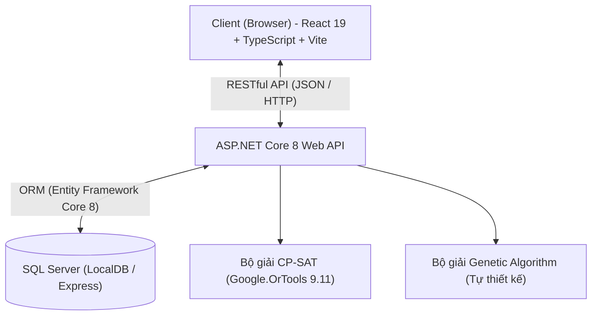
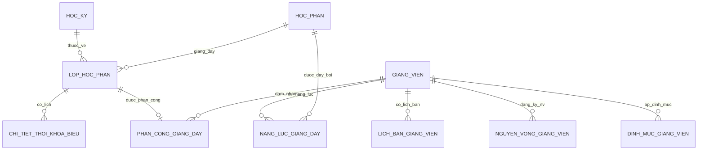
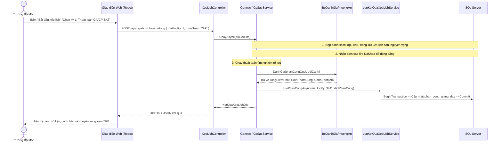

# CẨM NANG HỌC VÀ LÀM CHỦ 100% DỰ ÁN XẾP LỊCH GIẢNG DẠY (DATN)

Tài liệu này được biên soạn nhằm giúp sinh viên hiểu rõ từng dòng code, nắm vững luồng dữ liệu (workflow) và tự tin thuyết trình cũng như trả lời mọi câu hỏi của hội đồng phản biện Đồ án Tốt nghiệp.

---

## MỤC LỤC
1. [Tổng quan Kiến trúc Hệ thống & Công nghệ](#1-tổng-quan-kiến-trúc-hệ-thống--công-nghệ)
2. [Bản đồ Cấu trúc Thư mục & Các File trọng yếu](#2-bản-đồ-cấu-trúc-thư-mục--các-file-trọng-yếu)
3. [Mô hình Dữ liệu (Database Schema) & Quan hệ giữa các bảng](#3-mô-hình-dữ-liệu-database-schema--quan-hệ-giữa-các-bảng)
4. [Luồng chạy Code End-to-End (Data Flow)](#4-luồng-chạy-code-end-to-end-data-flow)
5. [Mổ xẻ Chi tiết Thuật toán CP-SAT (Google OR-Tools)](#5-mổ-xẻ-chi-tiết-thuật-toán-cp-sat-google-or-tools)
6. [Mổ xẻ Chi tiết Giải thuật Di truyền (Genetic Algorithm - GA)](#6-mổ-xẻ-chi-tiết-giải-thuật-di-truyền-genetic-algorithm---ga)
7. [Hệ thống Đánh giá Ràng buộc (BoDanhGiaPhuongAn)](#7-hệ-thống-đánh-giá-ràng-buộc-bodanhgiaphuongan)
8. [Bộ câu hỏi Phản biện thường gặp & Câu trả lời chuẩn 10 điểm](#8-bộ-câu-hỏi-phản-biện-thường-gặp--câu-trả-lời-chuẩn-10-điểm)

---

## 1. TỔNG QUAN KIẾN TRÚC HỆ THỐNG & CÔNG NGHỆ

Dự án áp dụng mô hình kiến trúc **Client - Server (Single Page Application + RESTful Web API)** phân tách hoàn toàn giữa Frontend và Backend.



### Công nghệ Backend:
- **Ngôn ngữ & Runtime:** C# 12, .NET 8.0 SDK (ASP.NET Core Web API).
- **ORM:** Entity Framework Core 8 (Code-First với Migration).
- **Bộ giải tối ưu hóa:** `Google.OrTools` v9.11.4210 (CP-SAT solver).
- **Xử lý Excel:** `ClosedXML` v0.104.2 (Đọc và xuất file Excel thời khóa biểu).
- **Bảo mật & Mã hóa:** `BCrypt.Net-Next` (Hash mật khẩu người dùng), `System.IdentityModel.Tokens.Jwt` (Xác thực JWT Token không lưu trạng thái).
- **Kiểm thử tự động:** `xUnit`, `Moq`, `Microsoft.EntityFrameworkCore.InMemory` (34 test cases bao phủ 100% thuật toán).

### Công nghệ Frontend:
- **Framework:** React 19, TypeScript, Vite.
- **Routing & State:** `react-router-dom` v7.
- **Giao diện & Biểu đồ:** Bootstrap 5, Bootstrap Icons, `recharts` (Vẽ biểu đồ so sánh hội tụ, radar chart chỉ số tải).
- **HTTP Client:** `axios` (kèm Interceptor tự đính kèm JWT Token vào Header).

---

## 2. BẢN ĐỒ CẤU TRÚC THƯ MỤC & CÁC FILE TRỌNG YẾU

### A. Backend (`DoAnXepLich/backend/XepLichGiangDay.Api`)

```
XepLichGiangDay.Api/
├── Controllers/
│   ├── AuthController.cs          # Đăng nhập, lấy thông tin cá nhân
│   ├── HocKyController.cs         # Quản lý học kỳ, năm học
│   ├── ThoiKhoaBieuController.cs  # Import Excel lớp học phần, tra cứu TKB
│   ├── GiangVienController.cs     # Danh sách GV, năng lực chuyên môn, lịch bận
│   ├── NguyenVongController.cs    # Đăng ký và duyệt nguyện vọng giảng dạy
│   └── XepLichController.cs       # KÍCH HOẠT THUẬT TOÁN (GA, CP-SAT, So sánh, Phân công thủ công)
├── Models/
│   └── Entities/                  # 14 Entities ánh xạ trực tiếp bảng CSDL
├── Data/
│   └── AppDbContext.cs            # Cấu hình Fluent API, quan hệ bảng, indexes
├── Services/
│   ├── ThuatToan/
│   │   ├── CpSat/
│   │   │   └── CpSatAlgorithmService.cs   # Lõi thuật toán quy hoạch ràng buộc CP-SAT
│   │   ├── Genetic/
│   │   │   ├── GeneticAlgorithmService.cs # Lõi điều phối vòng lặp tiến hóa GA
│   │   │   ├── CaThe.cs                   # Cấu trúc nhiễm sắc thể (Chromosome/Gene)
│   │   │   ├── KhoiTaoQuanThe.cs          # Khởi tạo quần thể ngẫu nhiên & Heuristic
│   │   │   ├── ChonLoc.cs                 # Toán tử chọn lọc giải đấu (Tournament Selection)
│   │   │   ├── LaiGhep.cs                 # Toán tử lai ghép đồng nhất (Uniform Crossover)
│   │   │   ├── DotBien.cs                 # Toán tử đột biến thích nghi (Adaptive Mutation)
│   │   │   └── SuaCaThe.cs                # Toán tử sửa lỗi Heuristic (Repair Operator)
│   │   └── LuuKetQuaXepLichService.cs     # Lưu kết quả giao dịch an toàn, bảo vệ lớp đã khóa
│   ├── RangBuoc/
│   │   ├── BoDanhGiaPhuongAn.cs   # Trọng tài độc lập tính điểm phạt & kiểm tra vi phạm
│   │   ├── BoKiemTraRangBuoc.cs   # Kiểm tra xung đột tức thì khi can thiệp thủ công
│   │   └── TaoDanhSachUngVien.cs  # Lọc giảng viên đủ điều kiện chuyên môn cho từng lớp
│   └── XepLichService.cs          # Service tổng hợp: lấy ma trận, xuất Excel, thống kê tải
└── Program.cs                     # Cấu hình Dependency Injection, CORS, JWT Auth
```

---

## 3. MÔ HÌNH DỮ LIỆU (DATABASE SCHEMA) & QUAN HỆ



### Ý nghĩa các trường đặc thù trong `phan_cong_giang_day`:
- `MaLopHocPhan`: Khóa ngoại duy nhất (Unique Index), mỗi lớp chỉ có tối đa 1 phân công trong CSDL.
- `TrangThai`: 
  - `"DuKien"`: Phân công do máy tính tự động xếp hoặc do người dùng gán nháp.
  - `"DaKhoa"`: Lớp đã được Trưởng bộ môn chốt cứng; khi chạy lại bất kỳ thuật toán nào, lớp này **tuyệt đối không bị thay đổi**.
- `NguonPhanCong`: Đánh dấu nguồn gốc phân công (`"CP_SAT"`, `"GA"`, hoặc `"ThuCong"`).

---

## 4. LUỒNG CHẠY CODE END-TO-END (DATA FLOW)



---

## 5. MỔ XẺ CHI TIẾT THUẬT TOÁN CP-SAT (GOOGLE OR-TOOLS)

Thuật toán đặt tại: [`CpSatAlgorithmService.cs`](file:///c:/Users/ADMIN/Desktop/DATN/DoAnXepLich/backend/XepLichGiangDay.Api/Services/ThuatToan/CpSat/CpSatAlgorithmService.cs).

### 5.1. Khái niệm toán học
CP-SAT (**Constraint Programming - Satisfiability**) chuyển bài toán xếp lịch thành bài toán thỏa mãn ràng buộc mệnh đề số nguyên.

### 5.2. Biến quyết định (Decision Variables)
- $x_{i, j} \in \{0, 1\}$: Biến Boolean bằng $1$ nếu giảng viên $i$ được phân công dạy lớp $j$, bằng $0$ nếu không.
- $botrong_j \in \{0, 1\}$: Biến Boolean bằng $1$ nếu lớp $j$ tạm thời bị bỏ trống (do thiếu giảng viên chuyên môn hoặc xung đột không thể giải).

### 5.3. Ràng buộc cứng (Hard Constraints)
1. **Chuyên môn (Qualification):** Chỉ tạo biến $x_{i, j}$ nếu giảng viên $i$ có tên trong bảng `NangLucGiangDay` của môn học lớp $j$. Nếu không đủ năng lực, biến $x_{i, j}$ **không tồn tại** trong mô hình.
2. **Lịch bận cố định (Busy Time):** Nếu giảng viên $i$ bận vào Thứ/Tiết/Tuần của lớp $j$, ép $x_{i, j} = 0$.
3. **Trùng giờ dạy (No Overlapping):** Nếu 2 lớp $j_1$ và $j_2$ trùng thời gian học:
   $$\forall i: x_{i, j_1} + x_{i, j_2} \le 1$$
4. **Phân công duy nhất hoặc Bỏ trống:**
   $$\forall j: \sum_{i \in \text{UngVien}(j)} x_{i, j} + botrong_j = 1$$
5. **Bảo tồn lớp đã khóa (`DaKhoa`):**
   Nếu lớp $j$ đã được Trưởng bộ môn khóa cho giảng viên $k$: ép $x_{k, j} = 1$.
6. **Trần tải cứng theo tuần (Hard Weekly Quota):** Khống chế số tiết tối đa trong một tuần không quá $\max(\text{MaxTiet} + 12, 35)$ tiết để bảo vệ sức khỏe giảng viên.

### 5.4. Hàm mục tiêu (Objective Function)
Tối thiểu hóa tổng điểm phạt:
$$\min Z = \sum (x_{i, j} \cdot P_{\text{nguyện vọng}}) + \sum (botrong_j \cdot 50000) + \sum P_{\text{gom lịch}} + \sum P_{\text{cân bằng tải}}$$

---

## 6. MỔ XẺ CHI TIẾT GIẢI THUẬT DI TRUYỀN (GENETIC ALGORITHM - GA)

Thuật toán đặt tại thư mục: [`Services/ThuatToan/Genetic/`](file:///c:/Users/ADMIN/Desktop/DATN/DoAnXepLich/backend/XepLichGiangDay.Api/Services/ThuatToan/Genetic/).

### 6.1. Cấu trúc Nhiễm sắc thể (Chromosome / Cá thể)
- **Mã hóa số nguyên trực tiếp (Integer Value Encoding):**
  Mỗi **Cá thể** (`CaThe`) đại diện cho một phương án phân công toàn trường.
  - Danh sách Gen (`DanhSachGen`): Mỗi **Gen** tương ứng với 1 lớp học phần:
    $$\text{Gen} = \{\text{MaLopHocPhan}: j, \text{MaGiangVien}: i\}$$

### 6.2. Các bước tiến hóa trong vòng lặp GA
1. **Khởi tạo Quần thể (`KhoiTaoQuanThe.cs`):**
   - Áp dụng kỹ thuật **Heuristic Seeding**: Không khởi tạo hoàn toàn ngẫu nhiên mà ưu tiên gán giảng viên có nguyện vọng ca dạy phù hợp và không trùng giờ.
   - Các lớp có cờ `DaKhoa` được ghim cứng $100\%$ ngay từ khâu khởi tạo.
2. **Đánh giá Thích nghi (`Fitness Function`):**
   - Điểm thích nghi được nghịch đảo từ tổng điểm phạt:
     $$\text{Fitness} = \frac{1.0}{1.0 + \text{DiemPhat}}$$
   - Sắp xếp cá thể theo quy tắc phân tầng: Cá thể ít vi phạm cứng hơn luôn xếp trên; nếu cùng vi phạm cứng thì so sánh tổng điểm phạt mềm.
3. **Bảo toàn Tinh hoa (`Elitism`):**
   - Copy nguyên vẹn $k$ cá thể tốt nhất ($k = 2$) sang thế hệ tiếp theo mà không cho qua lai ghép hay đột biến, đảm bảo nghiệm tốt nhất không bao giờ bị thụt lùi.
4. **Chọn lọc Giải đấu (`ChonLoc.cs` - Tournament Selection):**
   - Lấy ngẫu nhiên $K$ cá thể (mặc định $K=3$), chọn cá thể có độ thích nghi cao nhất làm cha/mẹ. Phương pháp này duy trì áp lực chọn lọc tốt và chống hội tụ sớm.
5. **Lai ghép Đồng nhất (`LaiGhep.cs` - Uniform Crossover):**
   - Duyệt qua từng gen của cha và mẹ: với xác suất $50\%$, con nhận gen từ cha; $50\%$ còn lại nhận từ mẹ. Các gen của lớp đã khóa được giữ nguyên.
6. **Đột biến Thích nghi (`DotBien.cs` - Adaptive Mutation):**
   - Xác suất đột biến cơ sở: $5\%$.
   - **Cơ chế Thích nghi:** Khi quần thể bị trì trệ $\ge 8$ thế hệ liên tiếp mà chưa đạt nghiệm hợp lệ, tỷ lệ đột biến tự động tăng lên đến $20\%$ để thoát khỏi cực tiểu địa phương.
7. **Toán tử Sửa lỗi (`SuaCaThe.cs` - Repair Operator):**
   - Sau khi lai ghép/đột biến, nếu phát hiện giảng viên bị trùng 2 lớp cùng giờ hoặc vướng lịch bận, thuật toán quét tìm trong danh sách ứng viên có chuyên môn của lớp đó để đổi sang giảng viên khác đang rảnh giờ.

---

## 7. HỆ THỐNG ĐÁNH GIÁ RÀNG BUỘC (BODANHGIAPHUONGAN)

File: [`BoDanhGiaPhuongAn.cs`](file:///c:/Users/ADMIN/Desktop/DATN/DoAnXepLich/backend/XepLichGiangDay.Api/Services/RangBuoc/BoDanhGiaPhuongAn.cs).

Đây là **"Trọng tài độc lập"** dùng chung cho cả GA, CP-SAT và Phân công thủ công để đảm bảo tính khách quan và nhất quán.

| Loại ràng buộc | Tên ràng buộc | Cách tính điểm phạt | Trọng số mặc định |
| :--- | :--- | :--- | :--- |
| **CỨNG (Hard)** | Sai năng lực chuyên môn | $+10,000$ điểm / vi phạm | Bắt buộc thỏa mãn |
| **CỨNG (Hard)** | Trùng giờ dạy của giảng viên | $+10,000$ điểm / vi phạm | Bắt buộc thỏa mãn |
| **CỨNG (Hard)** | Trùng lịch bận cố định của GV | $+10,000$ điểm / vi phạm | Bắt buộc thỏa mãn |
| **CỨNG (Hard)** | Bỏ trống lớp (chưa có GV) | $+5,000$ điểm / lớp | Bắt buộc thỏa mãn |
| **MỀM (Soft)** | Vi phạm nguyện vọng buổi dạy (Sáng/Chiều/Tối) | $+10$ điểm / buổi lệch | Trọng số $w_1 = 1.0$ |
| **MỀM (Soft)** | Gom lịch (dạy phân tán quá nhiều ngày/tuần) | $+5$ điểm / ngày vượt quá 4 ngày | Trọng số $w_2 = 1.0$ |
| **MỀM (Soft)** | Cân bằng tải (vượt trần tuần hoặc thiếu tải kỳ) | $+8$ điểm / tiết lệch định mức | Trọng số $w_3 = 1.5$ |

> [!NOTE]
> Chuẩn hóa định mức: Giảng viên có trần tối đa theo quy định là **25 tiết/tuần**. Hệ thống kiểm tra trần này trên từng tuần học thực tế chứ không cào bằng theo tổng số tiết cả học kỳ.

---

## 8. BỘ CÂU HỎI PHẢN BIỆN THƯỜNG GẶP & CÂU TRẢ LỜI CHUẨN 10 ĐIỂM

### Câu 1: Tại sao đồ án lại cài đặt cả 2 thuật toán GA và CP-SAT mà không chọn 1 cái?
**Trả lời:** 
> *"Dạ thưa Thầy/Cô, việc cài đặt song song 2 thuật toán xuất phát từ mục tiêu đối sánh khoa học của đồ án:
> - **CP-SAT (Google OR-Tools):** Là phương pháp quy hoạch ràng buộc chính xác (Exact/Constraint Solver). Ưu điểm là chứng minh được tính tối ưu toàn cục (Optimal) và chạy rất nhanh trên không gian ràng buộc chặt.
> - **GA (Genetic Algorithm):** Là thuật toán tìm kiếm phỏng sinh học (Meta-heuristic). Ưu điểm là linh hoạt, dễ tùy biến hàm mục tiêu phi tuyến phức tạp mà không cần tuyến tính hóa.
> Việc so sánh cả hai trên cùng một bộ dữ liệu thực tế giúp nhà trường có cái nhìn thực chứng: thuật toán nào tối ưu hơn về thời gian, chất lượng phân công và độ thỏa mãn giảng viên."*

### Câu 2: Nếu một lớp học phần chỉ có 1 giảng viên biết dạy, nhưng giảng viên đó bị trùng lịch bận cố định thì hệ thống xử lý thế nào?
**Trả lời:**
> *"Dạ, đây là trường hợp bài toán bị xung đột ràng buộc cứng không thể giải.
> - Trong **CP-SAT**: Hệ thống sử dụng biến mềm `botrong_j` kèm điểm phạt cao ($50,000$). Thuật toán sẽ chủ động để trống lớp đó và xếp lịch thành công cho các lớp còn lại với trạng thái `KhaThiMotPhan`, sau đó cảnh báo rõ cho Trưởng bộ môn biết lớp nào chưa có giảng viên.
> - Trong **GA**: Thuật toán sẽ ghi nhận vi phạm cứng và thông báo chi tiết trên giao diện. Trưởng bộ môn có thể can thiệp thủ công hoặc điều chỉnh lại lịch bận của giảng viên."*

### Câu 3: Làm thế nào hệ thống đảm bảo các phân công đã chốt không bị ghi đè khi chạy lại thuật toán?
**Trả lời:**
> *"Dạ, hệ thống áp dụng cơ chế **Soft-Lock (Khóa mềm)** thông qua trạng thái `DaKhoa` trong bảng `phan_cong_giang_day`:
> - Khi Trưởng bộ môn bấm 'Khóa', lớp đó được đánh dấu `DaKhoa`.
> - Khi chạy CP-SAT: Hệ thống thêm ràng buộc đẳng thức cứng ép biến $x_{\text{gv}, \text{lop}} = 1$.
> - Khi chạy GA: Các gen của lớp đã khóa được đóng băng $100\%$ ở khâu khởi tạo, toán tử lai ghép và toán tử đột biến.
> - Khi lưu vào CSDL: `LuuKetQuaXepLichService` chạy trong Transaction, đọc lại trạng thái mới nhất và bỏ qua không ghi đè bất kỳ bản ghi nào có trạng thái `DaKhoa`."*

### Câu 4: Phân quyền của hệ thống được tổ chức như thế nào?
**Trả lời:**
> *"Dạ, hệ thống phân chia rõ ràng theo 3 nhóm quyền (RBAC):
> 1. **GiangVien:** Chỉ xem thời khóa biểu của cá nhân, đăng ký lịch bận và nguyện vọng giảng dạy đầu kỳ.
> 2. **GiaoVu:** Nhập dữ liệu thời khóa biểu từ Excel, quản lý danh mục học phần, giảng viên, phòng học.
> 3. **TruongBoMon:** Có toàn quyền cao nhất: Chạy thuật toán xếp lịch tự động, xem Dashboard đối sánh chỉ số 2 thuật toán, can thiệp đổi giảng viên thủ công và chốt khóa (`DaKhoa`) bảng phân công."*
